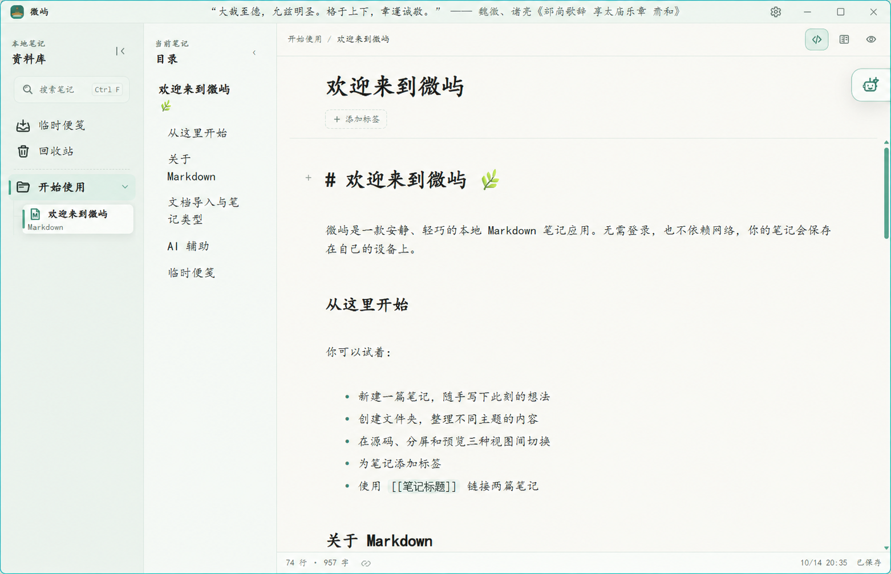

# Cay（微屿）

一个本地优先、轻量的笔记应用。Cay（微屿）不要求登录，也不依赖网络，笔记内容保存在自己的设备上。支持 Markdown 与富文档笔记，并可在资料库中管理多种格式的文件。



## 核心特点

- 本地优先：离线即可使用，Markdown 文件是可长期保存的内容。
- 富文档笔记：支持标题、格式刷、内容块、列表、任务、链接、图片、表格和单元格合并。
- 文档整理：支持正文对齐、字体与字号、标题层级编辑、目录折叠，以及表格横向滚动和直接选中。
- 多格式兼容：可导入 Markdown、TXT、PDF、图片及 Word/Excel/PowerPoint 文件；DOCX 可转换为文档笔记，现代 Office 提供本地内容预览和外部编辑保存同步。
- 多格式导出：Markdown、TXT、HTML、DOCX、PDF 另存为，可选择文件名和保存目录。
- 资料库管理：通过文件夹组织笔记，支持侧栏原位搜索、标签和笔记间链接。
- 图片保存：可选高清压缩、省空间压缩或保留原图；新静态图片默认使用高清压缩。
- 三种编辑视图：源码、分栏和预览，适合快速记录与整理。
- 临时便笺：先快速捕捉想法，再整理为正式笔记。
- 安全恢复：删除内容进入回收站，可在需要时恢复。
- 可选 AI 总结：按需生成全文总结，整合图片信息、保存总结并提供可切换的重点标注；需自行配置 DeepSeek API Key 和联网，查看已保存结果不会自动请求模型。
- 轻量界面：温暖、圆润、低干扰，适合长时间阅读和写作。

## 最新版本

当前公开稳定版本为 [Cay v1.1.4](https://github.com/Tiome-tt/weiyu-cay/releases/latest)。

v1.1.4 提供 Windows x64 和 macOS（Intel / Apple Silicon）安装包及签名更新元数据。本版增加多格式另存为、Office 内容预览与外部编辑同步，改进代码块、表格和主题设置，优化笔记与图片加载，并支持 Windows 首次安装选择资料库目录。完整变更和验证范围见 [CHANGELOG.md](CHANGELOG.md)。

## Windows 安装

可前往 [Cay v1.1.4 Release](https://github.com/Tiome-tt/weiyu-cay/releases/tag/v1.1.4) 下载 Windows x64 安装包。

- [`_1.1.4_x64-setup.exe`](https://github.com/Tiome-tt/weiyu-cay/releases/download/v1.1.4/_1.1.4_x64-setup.exe)：普通用户推荐，双击即可安装。
- [`_1.1.4_x64_en-US.msi`](https://github.com/Tiome-tt/weiyu-cay/releases/download/v1.1.4/_1.1.4_x64_en-US.msi)：需要 MSI 安装包时使用。

## macOS 安装

可在 [Cay v1.1.4 Release](https://github.com/Tiome-tt/weiyu-cay/releases/tag/v1.1.4) 中选择对应芯片的安装包：

- [`_1.1.4_x64.dmg`](https://github.com/Tiome-tt/weiyu-cay/releases/download/v1.1.4/_1.1.4_x64.dmg)：Intel 芯片 Mac。
- [`_1.1.4_aarch64.dmg`](https://github.com/Tiome-tt/weiyu-cay/releases/download/v1.1.4/_1.1.4_aarch64.dmg)：Apple 芯片 Mac。

首次打开如果出现系统安全提示，请在系统设置中允许打开微屿。

## 自动更新

v1.1.4 发布包包含签名的更新清单和更新包。应用内的“检查更新”操作会查询 GitHub 最新稳定版本；发现新版本后，由用户确认下载、安装并重启，不会在后台静默安装。平台安装包仍未做系统代码签名或 macOS 公证，不能将更新包签名等同于系统发行者认证。

## 从源码运行

```powershell
pnpm install
pnpm tauri dev
```

常用检查命令：

```powershell
pnpm typecheck
pnpm test
pnpm tauri build
```

## 特别感谢

感谢每一位通过反馈帮助微屿变得更可靠的用户和开发者。

| 贡献者 | 主页 |
| --- | --- |
| Wiem-coder | [GitHub](https://github.com/Wiem-coder) |
| zwt147 | [GitHub](https://github.com/zwt147) |

## 项目状态

当前公开稳定版本为 v1.1.4。项目仍在持续完善中，欢迎通过 [Issues](https://github.com/Tiome-tt/weiyu-cay/issues) 反馈问题或建议。
