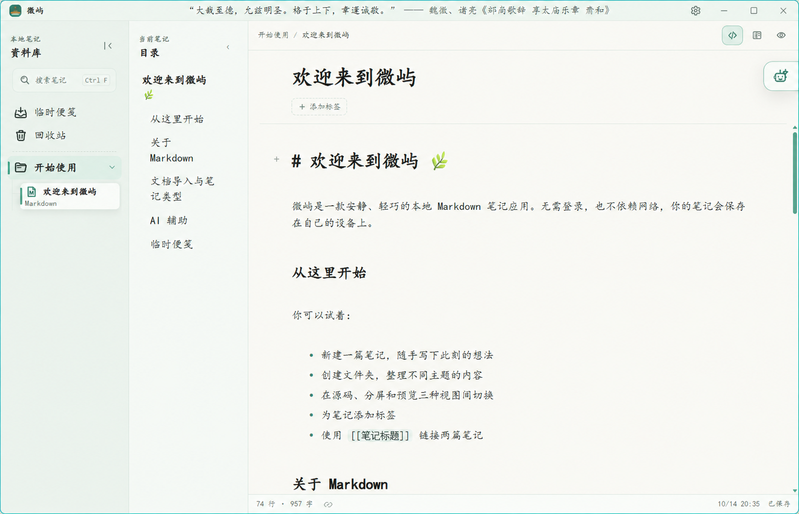

# Cay（微屿）

一个本地优先、轻量的笔记应用。Cay（微屿）不要求登录，也不依赖网络，笔记内容保存在自己的设备上。支持 Markdown 与富文档笔记，并可在资料库中管理多种格式的文件。



## 核心特点

- 本地优先：离线即可使用，Markdown 文件是可长期保存的内容。
- 富文档笔记：支持标题、格式刷、内容块、列表、任务、链接、图片、表格和单元格合并。
- 文档整理：支持正文对齐、字体与字号、标题层级编辑、目录折叠，以及表格横向滚动和直接选中。
- 多格式兼容：可拖入文件或文件夹；支持 PDF 阅读进度恢复、页码跳转和 300% 缩放，以及隔离的 HTML 预览。DOCX 可转换为文档笔记，现代 Office 提供本地内容预览和外部编辑保存同步。
- 多格式导出：Markdown、TXT、HTML、DOCX、PDF 另存为，可选择文件名和保存目录。
- 资料库管理：通过文件夹组织笔记，支持侧栏原位搜索、标签、笔记间链接和两层引用图谱。
- 图片保存：可选高清压缩、省空间压缩或保留原图；新静态图片默认使用高清压缩。
- 三种编辑视图：源码、分栏和预览，适合快速记录与整理。
- 临时便笺：先快速捕捉想法，再整理为正式笔记。
- 安全恢复：删除内容进入回收站，可在需要时恢复。
- 可选 AI 总结：Markdown、富文档和纯文本笔记可按需生成总结，整合图片信息、保存总结并提供可切换的重点标注；需自行配置 DeepSeek API Key 和联网，查看已保存结果不会自动请求模型。
- 轻量界面：温暖、圆润、低干扰，适合长时间阅读和写作。

## 最新版本

当前公开稳定版本为 [Cay v1.1.5](https://github.com/Tiome-tt/weiyu-cay/releases/latest)。新增文件夹拖入、HTML 预览和引用图谱，并改进 PDF 阅读、表格和通知。完整变更见 [CHANGELOG.md](CHANGELOG.md)。

## 安装包

| 平台 | 中文 | English |
| --- | --- | --- |
| Windows x64（EXE） | [中文版](https://github.com/Tiome-tt/weiyu-cay/releases/download/v1.1.5/weiyu-cay_1.1.5_windows-x64-zh-CN.exe) | [English](https://github.com/Tiome-tt/weiyu-cay/releases/download/v1.1.5/weiyu-cay_1.1.5_windows-x64-en-US.exe) |
| macOS 通用（DMG，Intel / Apple Silicon） | [中文版](https://github.com/Tiome-tt/weiyu-cay/releases/download/v1.1.5/weiyu-cay_1.1.5_macos-universal-zh-CN.dmg) | [English](https://github.com/Tiome-tt/weiyu-cay/releases/download/v1.1.5/weiyu-cay_1.1.5_macos-universal-en-US.dmg) |

## 自动更新

中文和英文版本分别使用同语言的签名更新包。在设置中检查更新，由你确认下载、安装并重启。安装包未做系统代码签名或 macOS 公证。

## 从源码运行

### 安装环境

- 安装 [Git](https://git-scm.com/downloads/)、[Node.js 22](https://nodejs.org/en/download) 和 [Rust 稳定工具链](https://rust-lang.org/tools/install/)。
- Windows：按 [Tauri 环境安装指南](https://v2.tauri.app/start/prerequisites/#windows) 安装 C++ 构建工具（勾选“使用 C++ 的桌面开发”）和 WebView2。
- macOS：运行 `xcode-select --install` 安装 Xcode 命令行工具。
- 安装 [pnpm](https://pnpm.io/installation)：

```powershell
npm install -g pnpm@11.21.0
```

### 下载并运行

```powershell
git clone https://github.com/Tiome-tt/weiyu-cay.git
cd weiyu-cay
pnpm install --frozen-lockfile
pnpm tauri dev
```

## 特别感谢

感谢每一位通过反馈帮助微屿变得更可靠的用户和开发者。

| 贡献者 | 主页 |
| --- | --- |
| Wiem-coder | [GitHub](https://github.com/Wiem-coder) |
| zwt147 | [GitHub](https://github.com/zwt147) |

## 项目状态

当前公开稳定版本为 v1.1.5。项目仍在持续完善中，欢迎通过 [Issues](https://github.com/Tiome-tt/weiyu-cay/issues) 反馈问题或建议。
